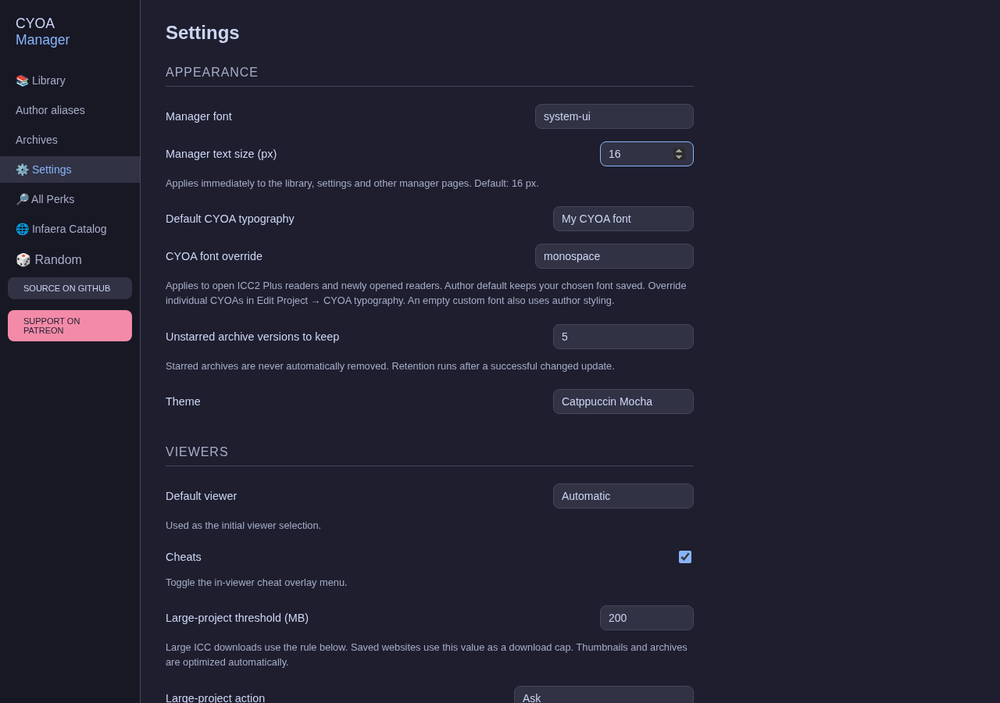

# CYOA Manager — Linux

The [EmpressAria89 fork](https://github.com/EmpressAria89/CYOA-Manager) is a **Linux-only fork** of [alexncode/CYOA-Manager](https://github.com/alexncode/CYOA-Manager), focused on a local CYOA library, readable themes, identified builds and preserved editions.

Development and native testing currently target **Linux x86_64**. Windows, macOS and other architectures are not maintained or tested in this fork. For the original project's platform and architecture releases, use the upstream repository.

## Features

- Import project files/folders, download CYOAs, or browse the Infaera catalog.
- Catppuccin Mocha, Macchiato, Frappé and Latte; separate manager and reader fonts, adjustable manager text size.
- Author, fandom, modder, player-status and tag filters; persistent personal author aliases.
- Builds associated with their CYOA, viewer and edition, with native save/load and legacy recovery.
- Version history, starred editions, duplicate detection and change reports on re-download.
- Verified lossless archive compression and automatic library thumbnail optimization.
- Internal saved website snapshots, plus an online reader for dynamic sites.
- ICC2 Plus by default; legacy viewers remain available when needed.
- Windowed startup. ICC2 Plus can preview hidden choices and bonuses within sections you open.
- Live reader typography by text section, pinned per-CYOA overrides, density controls, cost/gain colors and optional section hiding.
- Public keyless catalog access, shared cached metadata and protected startup on storage errors.

## Interface



Settings preview from a synthetic test session. Manager text size, reader typography and appearance are independent.

## Run a Linux package

Extract the Linux package, then run from its folder:

```bash
./launch.sh
```

For driver-related flickering or blank surfaces:

```bash
./launch.sh --compatibility
```

To add a desktop menu entry, first preview it with `python3 install-menu.py`, then apply it with `python3 install-menu.py --apply`. Keep the extracted package in a permanent location before installing the shortcut. Packages use system WebKitGTK and dav1d libraries; a portable archive does not bundle every system dependency.

## Develop and build

Install Node.js, pnpm, Rust and the [Tauri Linux prerequisites](https://v2.tauri.app/start/prerequisites/#linux), including **dav1d development headers** for AVIF thumbnails.

Development and test commands require a source checkout, rather than an extracted runtime package. From the repository root:

```bash
pnpm install --frozen-lockfile
pnpm tauri dev
```

Build and package a standalone Linux executable:

```bash
pnpm release:linux
python3 scripts/package-linux.py
```

The binary is `src-tauri/target/release/cyoa-manager`; the package is under `release/`. A standalone release requires the `custom-protocol` feature so it opens embedded assets instead of a localhost development server. `release:linux` includes that feature and verifies the embedded assets.

## Documentation and tests

- [Linux user guide](docs/linux-guide.md): importing, themes, aliases, builds, archives and hidden-choice previews.
- [Development](docs/development.md): dependencies, tests, packaging and source layout.
- [Storage and recovery](docs/storage-and-recovery.md): data locations, backups and rollback.
- [Requirements checklist](docs/requirements-checklist.md): implemented behavior and verification limits.
- [Maintainer handoff](HANDOFF.md), [roadmap](docs/roadmap.md) and [audit](docs/audit-2026-10-16.md).
- [GitHub publication](docs/github-publication.md): validated one-time source export, keeping the working folder detached.
- [Tests](tests/README.md): retained regression checks; private results and fixtures are ignored by Git.

Vue/TypeScript lives in `src/`, Rust in `src-tauri/src/`, bundled viewers in `public/viewers/`, tests in `tests/`, and packaging/recovery tools in `scripts/`.

## Credits

This fork was developed with AI assistance; the dated audit documents verification and remaining limitations.

This fork retains the upstream project and bundled viewer credits: ICC Original by MeanDelay, ICC2 Plus by Wahaha303, and Om1cr0n's viewer. Catalog data comes from the [Infaera index](https://docs.google.com/spreadsheets/d/1jxBbWB08myhD8YXePPifsWQG3JH2qZtBs9Y5yYcqE7g/). See [LICENSE](LICENSE) for the manager license; CYOAs and bundled third-party material retain their own ownership.

Catalog search, offline snapshots, original-viewer fallback and reviewed updates are described in [the catalog guide](docs/catalog.md). Implementation decisions and resumable scope are in [the catalog specification](docs/specs/catalog-redesign.md).

For current review coverage and remaining proof gaps, read [skill assurance](docs/skills-assurance.md). [Next reliability slices](docs/specs/assurance-followups.md) provide implementation steps and acceptance conditions while retaining the later catalog, archive and reader decisions.
